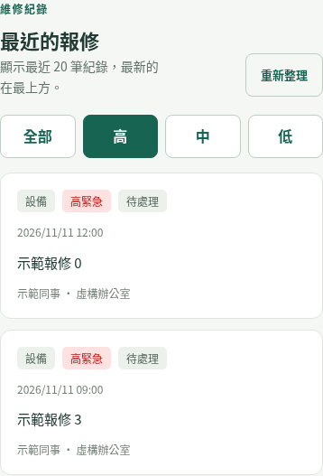

雲端任務測試

[報修欄位表](文件/報修欄位表.xlsx)

[報修系統操作說明（Word）](文件/報修系統操作說明.docx)

[報修登記系統提案（PowerPoint）](文件/報修登記系統提案.pptx)

## 報修登記網頁

首頁為根目錄 `index.html`，使用純 HTML/CSS/JavaScript，透過 CDN 載入 supabase-js v2，不需要建置。

- GitHub Pages 預期網址：https://vjs7w9c5d8-tech.github.io/repair-system/
- Pages 設定：Deploy from a branch → `main` → `/ (root)`。
- 在 Supabase 執行 `supabase/schema.sql`，設定資料表、欄位授權及 RLS。
- `config.js` 的 `supabaseUrl` 已設定為 `https://lnimvlaxyozckrypjbbs.supabase.co`。這是 Supabase Project URL，與 GitHub Pages 發佈網址不同；未設定時頁面會顯示提示並停用送出。
- `supabasePublishableKey` 已填入提供的公開金鑰；禁止換成 secret 或 service-role 金鑰。

新增僅傳送 `reporter_name`、`location`、`category`、`description`、`urgency`，由資料庫產生 `status`、`created_at`、`id`。清單依 `created_at` 降冪取最近 20 筆，時間以台北時區顯示。公開示範請只使用虛構資料。

## 清單緊急程度篩選

清單上方提供「全部／高／中／低」按鈕，預設為「全部」。目前選取的按鈕以深綠底白字顯示，並提供 `aria-pressed` 狀態。篩選僅使用網頁已讀取的最近 20 筆資料，不會額外查詢資料庫，也不會涵蓋更早的報修；原本由新到舊的順序不變。若該程度沒有符合紀錄，會顯示提示。

緊急程度為「高」的標籤使用紅字與淺紅底。按「重新整理」或成功送出報修後，會重新讀取最近 20 筆並保留目前篩選。此次只調整前端與說明，沒有新增欄位或變更資料庫、RLS、`supabase/` 資料夾。

手機確認：向下滑到「最近的報修」，依序點選「高／中／低」，確認只出現對應程度、按鈕選取狀態清楚；點「全部」可恢復完整清單。「高緊急」標籤應為紅色，沒有符合紀錄時應顯示提示。PR 尚未合併時，正式 GitHub Pages 不會更新，請先在 PR 分支啟動本機預覽。

## PWA 安裝與離線

網站提供 Web App Manifest、桌面圖示及 Service Worker，可在支援的瀏覽器安裝為獨立視窗。Android Chrome 可按頁面出現的「安裝報修登記」或瀏覽器選單「安裝應用程式」；iPhone 請使用 Safari 分享選單的「加入主畫面」。安裝入口是否出現由瀏覽器決定，需使用 HTTPS（GitHub Pages）或 localhost；手機直接開啟區網 HTTP 網址無法驗證 PWA 安裝。

先連線開啟一次，等待快取就緒後，即可離線重開頁面。Service Worker 只快取固定靜態頁面、圖示及成功載入的 Supabase CDN 程式庫，不快取資料庫 API、報修清單或填寫內容。離線時會顯示提示，新增及讀取最新清單仍需要網路；不提供離線排程、自動重送或持久保存草稿。重新載入會遺失未送出的內容；若 CDN 尚未快取，離線時表單會顯示程式庫載入失敗提示。

連線恢復後可手動重新整理清單或再按送出。新版本下載完成時會提供「更新並重新載入」按鈕，請先處理未送出的表單再更新。每次修改靜態資源時，需一併更新 `sw.js` 的快取版本。Manifest 的相對網址及 Service Worker 範圍皆支援 GitHub Pages 的 `/repair-system/` 子目錄。

## 開發與驗證

在儲存庫根目錄執行 `npm ci`，再執行 `npm run dev`，瀏覽 `http://localhost:8000`。

`npm run lint` 檢查格式與 JavaScript 語法；`npm test` 使用 Playwright 與本機 Chromium（可用 `CHROMIUM_PATH` 指定執行檔），以模擬 API 檢查手機版、必填驗證、資料欄位、排序查詢、成功／錯誤訊息及 HTML 注入防護。測試不會寫入真實資料庫。實際資料庫連線及 RLS 仍需在 Project URL 設定完成後驗證。

PWA 測試另以本機 `/repair-system/` 子目錄驗證 Chromium 解析 Manifest、靜態快取與離線重開、離線禁止送出、恢復連線後手動送出，以及新版本提示／使用者更新／舊快取清理。測試使用模擬 SDK 與虛構資料，不驗證真實 Supabase 連線，也不代表已在 iPhone 或 Android 實機完成安裝。可用 `PWA_SCREENSHOT_PATH=/tmp/pwa.png npm test` 匯出離線畫面。
